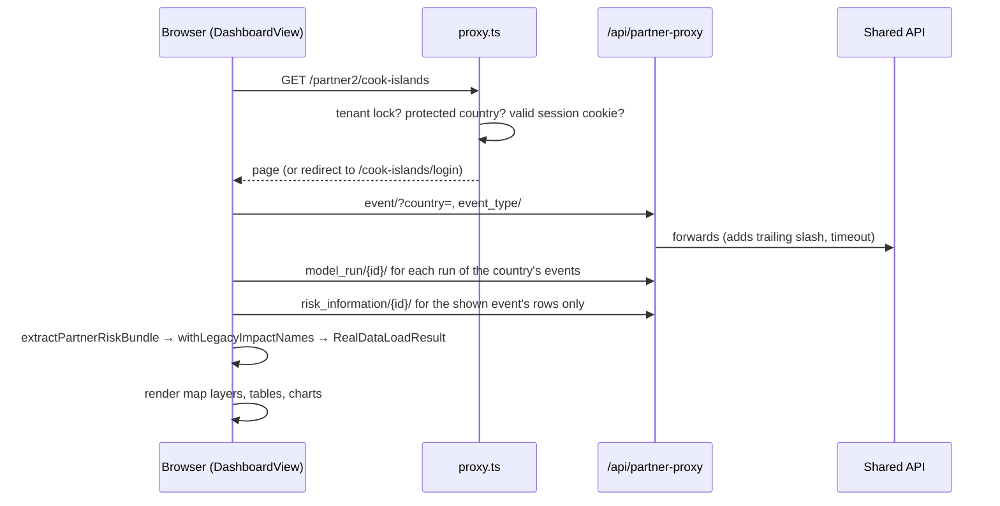

# Architecture

## Components

```mermaid
flowchart TB
  subgraph Browser
    DV[DashboardView<br/>orchestrator] --> MAP[MapPanel / MapView<br/>MapLibre + deck.gl]
    DV --> SIDE[FilterPanel, SummaryPanel,<br/>ForecastSetupPanel]
    DV --> TABS[BottomTabs<br/>tables and charts]
    DV --> PDF[ExportButtons, PDFPreviewModal<br/>jsPDF + html2canvas]
    DV --> LOADER[realDataLoader.ts<br/>loadAllRealData]
    W[workers/<br/>dataParser, windGlow] -.-> MAP
  end
  subgraph Next[Next.js server :3002 dev / :3112 prod]
    PX[src/proxy.ts<br/>routing, auth gate, tenant lock]
    PP[/api/partner-proxy/...]
    EV[/api/events, /api/cyclone, /api/auth/*,<br/>/api/operator/*, /api/health, /api/config/]
  end
  LOADER --> PP
  LOADER --> EV
  LOADER --> STATIC[(public/data/*)]
  PP -->|partner_api/...| SHARED[(Shared Partner API<br/>pacific-disaster-api.spc.int)]
  PP -->|thredds/...| THREDDS[(THREDDS WMS)]
  LOADER -->|direct, CORS| WASABI[(Wasabi: hazard zarr,<br/>scenario losses)]
  EV --> SHARED
```

- **Next.js 16 App Router, React 19, TypeScript.** Production builds use `output: 'standalone'` and run in a Docker image.
- **One page per country.** `/[country]` renders `DashboardView`. The page is mostly client-side: data is fetched in the browser through the server's proxy routes, so the server stays thin and the API URL and tokens stay server-side.
- **The proxy route does the network plumbing**: retries, timeouts, cache headers, trailing slashes on DRF paths, and the THREDDS host split. Code under `src/` that wants Partner API data calls `/api/partner-proxy/partner_api/v1/...` (via `prependBasePath`) and never the API host directly.
- **Large static hazard data skips the server.** The flood-depth zarr store and the scenario loss tables are read straight from the Wasabi bucket. See [`docs/HAZARD_CATALOG_ZARR.md`](../HAZARD_CATALOG_ZARR.md).

## A country page load



The loader reads the shared API **event first** and never asks for the full `risk_information` listing, which runs to over 100 MB. The details are in [Data sources and loading](Data-Sources-and-Loading.md).

## Request routing (`src/proxy.ts`)

`proxy.ts` is Next 16's request proxy, formerly called `middleware.ts`. For every request it:

1. **Checks the security config at import** (`validateSecurityConfigOrThrow`), so a protected country with no password or secret fails at startup, not on first login.
2. **Applies the tenant lock.** With `TENANT_COUNTRY` set, `/` redirects to that country and other countries are refused.
3. **Gates protected countries.** It verifies the signed session cookie through `/api/auth/verify-session`, with a local cookie check as fallback, and redirects to `/<slug>/login` when the session is missing.
4. **Scopes country APIs.** `/api/buildings`, `/api/roads`, `/api/regional-summary[-by-sector]` are limited to the session's country.
5. **Adds cache and CORS headers on data assets.** In dev these are `no-store`, so a fixed file is not hidden by a cached 404.

## State

| State | Where | Why there |
|---|---|---|
| Shareable view (event, mode, hazard scenario, filters, layers, map view) | URL query, `utils/urlState.ts` | A shared link reproduces exactly what the sender saw |
| Derived filtered data | `stores/filteredDataStore.ts` (zustand) | Memoised by input identity, so panels do not recompute |
| Loaded data | `DashboardView` state (`RealDataLoadResult`) | One load per country and event |
| User preferences (basemap, thresholds) | localStorage, `utils/userPreferences.ts`, `priorityStorage.ts` | Per browser, not shareable |
| Session | httpOnly cookies (`countryAuth.ts`, `operatorAuth.ts`) | Never readable by page JavaScript |

## The backend in this repo

`middleware/` is a Django REST project: our copy of the Partner API, with features the shared API lacks, such as `risk_scenario`, the model-run queue and `hazard_zarr`. It also holds the RiskScape model runners. It is deployed on opmthredds with its **own database**. The live dashboard does not read that copy. See [Backend (middleware)](Backend-Middleware.md).

## Design principles in the code

- **The API is authoritative for anything operational**, such as which advisory is newest, run status and issue times. `config/` holds only fallbacks and static layers ([config/README](../../config/README.md)).
- **One path for every event.** Event → model runs → risk files, whether it is a forecast, a post-disaster assessment or a scenario.
- **Old and new model formats side by side.** New output names are translated to the old shape at one boundary (`utils/pdieOutputs.ts`), so the rest of the UI does not change.
- **Fail loudly on bad data.** An empty model output is a failed run, not zero exposure. A misconfigured auth setup fails startup.
- **Base path everywhere.** Use `prependBasePath` from `utils/basePath.ts` for every fetch and asset URL.
