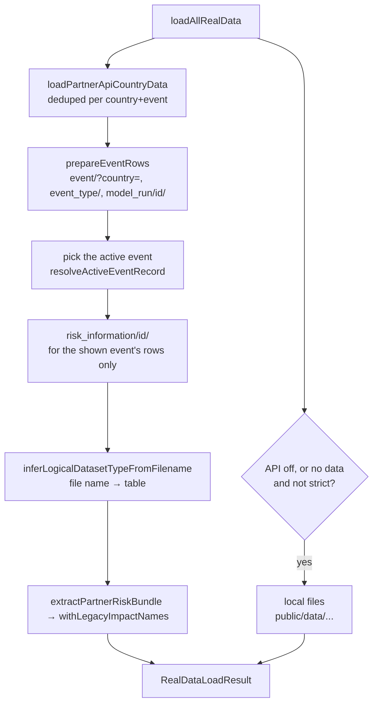

# Data sources and loading

## Where data comes from

| Source | What | How it is reached | Owner |
|---|---|---|---|
| **Shared Partner API** `https://pacific-disaster-api.spc.int/partner_api/v1/` | events, model runs, risk files, tracks, hazard rows | server-side, through `/api/partner-proxy/partner_api/v1/...` | Anuj (SPC) |
| **THREDDS** `https://gemthreddshpc.spc.int` | WMS tiles of static hazard layers | `/api/partner-proxy/thredds/...` (with retries) | SPC GEM |
| **Wasabi bucket** | flood-depth zarr store, scenario loss tables (`scenario_losses/v1`) | straight from the browser | SPC GEM |
| **Local files** `public/data/`, `public/<slug>/` | fallback events and tables | static assets | this repo |

### The two Partner APIs

There are two deployments of the same API design, and they must not be confused:

| | Shared API | Our middleware |
|---|---|---|
| URL | `pacific-disaster-api.spc.int` | `opmthredds.gem.spc.int/partner_api/v1` (container `middleware_web`, port 8800) |
| Code | Anuj's deployment, older | `middleware/` in this repo |
| Database | its own | its own, **different** ids and content |
| Read by the live dashboard | **yes, only this one** | no |
| Has `risk_scenario`, `dataset_type`, filters, `defer_large_assets`, `model_run/import/` | no | yes |

The running `partner2-dashboard` container has `PARTNER_API_BASE_URL=https://pacific-disaster-api.spc.int`. Checks of "what users see" must be made against the shared API. Writes to it go to a shared system, so agree them with Anuj first. Its quirks, such as routes instead of filters, auth and the open requests, are in [`docs/SHARED_API.md`](../SHARED_API.md).

## Turning the API on

`services/partnerApiService.ts`:

| Function | True when |
|---|---|
| `isPartnerApiEnabled()` | in the browser, `NEXT_PUBLIC_ENABLE_PARTNER_API=true`; on the server, that or `PARTNER_API_ENABLED=true` |
| `isPartnerApiCountryEnabled(cc)` | `cc` is in `NEXT_PUBLIC_PARTNER_API_COUNTRIES` (or `PARTNER_API_COUNTRIES`) |
| `isPartnerApiCountryStrict(cc)` | `cc` is in `*_PARTNER_API_STRICT_COUNTRIES`: no fallback to local files |

In the browser, the API base is always `prependBasePath('/api/partner-proxy')`, so requests stay same-origin. On the server it is `PARTNER_API_BASE_URL`. The country's record is found by code, then by the aliases in `config/countries/<slug>.json` (`partnerApi.aliases`).

## The proxy route

`src/app/api/partner-proxy/[...path]/route.ts`:

- `thredds/...` goes to `THREDDS_BASE_URL`, and everything else to `PARTNER_API_BASE_URL`.
- DRF paths get a trailing slash. File paths do not: a tile `12.png`, a zarr chunk, or anything under `hazard_zarr/` (`utils/partnerProxyPath.ts`).
- Only a fixed set of request headers is forwarded, including `authorization`, `range` and `if-none-match`.
- Timeouts: `PARTNER_PROXY_TIMEOUT_MS` (default 20 s), `PARTNER_DATA_TIMEOUT_MS` (60 s for data), `THREDDS_WMS_TIMEOUT_MS` (30 s). WMS is retried up to 3 times with a short backoff.
- Cache headers: WMS gets `public, max-age=300`. API data gets `private, max-age=120, stale-while-revalidate=600`. Data is private because some countries need a login, and the short age means a new advisory appears within minutes.
- `risk_scenario` and `risk_scenario_breakdown` do not exist on the shared API. The proxy turns their 404 into an empty list.

## How a country's data is loaded

Entry point: `loadAllRealData({ countryCode, selectedEventIds, dateRange })` in `utils/realDataLoader.ts`, called by `DashboardView`. It returns a `RealDataLoadResult` with events, regional impacts, tables, forecast exposure and the source of each part.



1. **Events.** `prepareEventRows` (`utils/partnerEvents.ts`) reads `event/?country=<id>` and `event_type/`, names each event's type, and follows each run (`model_run/{id}/`). If a run's track is filed under another country, it also reads `cyclone_track/{id}/`. It recognises the shared API by event rows that list `model_runs` but no `risks`. The same function feeds `/api/events`.
2. **Active event.** The one picked in the URL (`events=`). Otherwise the mode's default: in Forecast, the newest advisory with results.
3. **Risk files.** It reads `risk_information/{id}/` **only for the shown event's rows**, and other events' rows when they are shown. It never reads the paged listing, which is about 112 MB for one country on the shared API.
4. **Classify.** Each file is classified by its title or file name (see [Model outputs](Model-Outputs.md)), because the shared API has no `dataset_type`.
5. **Normalise.** `extractPartnerRiskBundle` merges the files into one bundle, and `withLegacyImpactNames` (`utils/pdieOutputs.ts`) renames the 2026 PDIE columns to the names the UI reads.
6. **Large assets later.** Damaged buildings and roads are read on demand (`fetchPartnerRiskInformationGeometry`, then `legacyAssetFeatures`). Supplementary data comes through `loadSupplementaryRealData`.

**Fallback.** If the API is off for a country, or returns nothing and the country is not strict, the loader reads the files named in `config/events/<slug>.json` from `public/data/`. The result says which source each part came from (`dataSourceInfo`: `cycloneTrackSource`, `eventMetadataSource`, `riskDataSource`, `hazardLayerSource`). The page shows them in its `Source: Track: … | Event: … | Risk: … | Hazards: …` line.

### Cost of a page

Measured on the shared API (30 Oct): Cook Islands with Wati shown takes 1.2 MB in 53 requests. Observed storms are heavy, Meena 27 MB, Lola 39 MB and Harold 24 MB, because their damaged-assets rows embed full geometry. Only an API list without geometry fixes that ([`SHARED_API.md`](../SHARED_API.md), ask 3).

## Other loaders

| Module | Use |
|---|---|
| `dataLoader.ts`, `fastDataLoader.ts`, `lazyDataLoader.ts`, `dataCache.ts` | older generic loaders and caching for local files |
| `csvParser.ts`, `csvDataNormalizer.ts`, `workers/dataParser.worker.ts` | CSV parsing, off the main thread for big files |
| `threddsLoader.ts`, `wmsTileCache.ts` | THREDDS catalogue and WMS tiles |
| `hazardZarr*.ts`, `zarrReader.ts` | flood depths from the zarr store (`NEXT_PUBLIC_HAZARD_ZARR_DIRECT=false` falls back to server-drawn tiles) |
| `scenarioLosses.ts` | scenario loss tables from Wasabi |
| `geotiffLoader.ts` | local GeoTIFF rasters |
| `cycloneAnimationLoader.ts` | track playback |

## Testing the shared API by hand

```bash
B=https://pacific-disaster-api.spc.int/partner_api/v1
curl -s "$B/event/country/3/"          # Cook Islands events
curl -s "$B/model_run/11/"             # one run: its risk ids and track
curl -s "$B/risk_information/114/"     # one result file
curl -s "$B/event_type/"               # 1 REF, 3 PDIE, 4 Scenario
```

`model_run` and `model` reads used to need a token. Run reads became public on 30 Oct. Never paste the API password into chat, commits or repo files.
