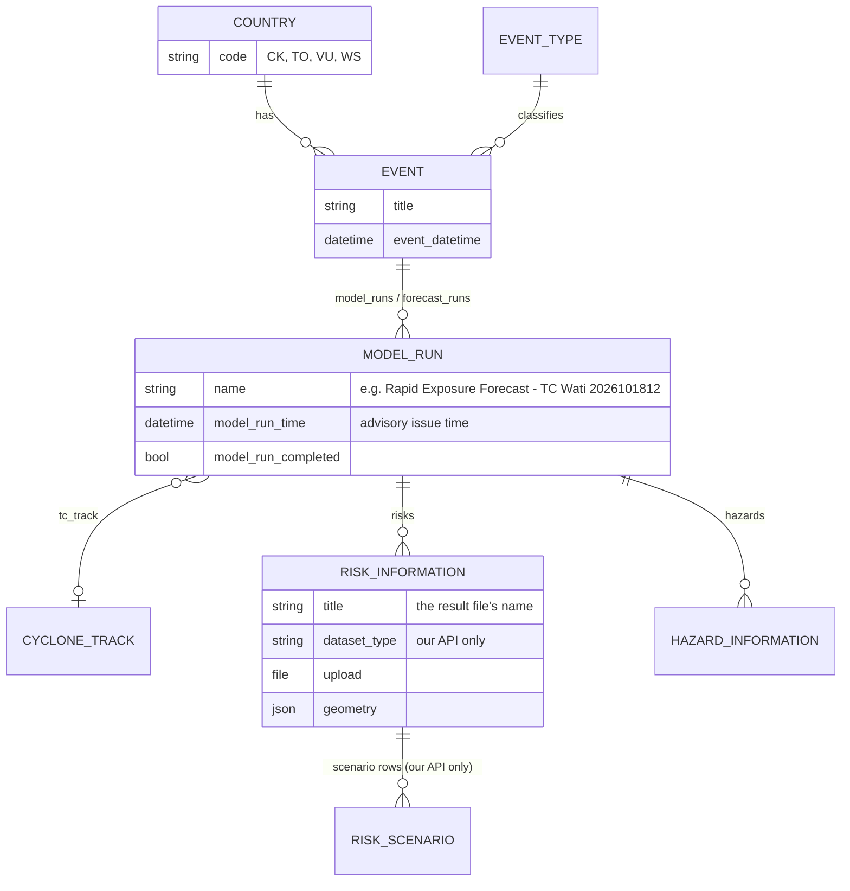

# Domain model

## The four questions the dashboard answers

The mode switch at the top of a country page (`components/AnalysisModeSwitch.tsx`) picks one question:

| Mode (`AnalysisMode`) | Label | Question | Data behind it |
|---|---|---|---|
| `forecast` | Forecast (REF) | What may be exposed under the latest advisory? | REF runs of a live storm, one per advisory |
| `assessment` | Post Disaster Analysis | What damage and loss occurred? | PDIE run on the post-event best track |
| `scenarios` | Scenarios | What could happen at a given return period and sea-level rise? | Hazard catalogue and scenario loss tables |
| `history` | History | What happened in previous cyclones and swell events? | Past observed events |

**REF** (Rapid Exposure Forecast) and **PDIE** (Pacific Disaster Impact & Exposure) are **different RiskScape models** with different outputs. REF counts what lies inside each wind band of a forecast track. PDIE estimates damage and loss, in money, buildings and road km, from the best track. Do not mix their tables.

## Entities

- **Country.** Identified in code by `CountryCode` (`'VU' | 'WS' | 'TO' | 'CK'`), which is generated from `config/`, and in URLs by its slug (`vanuatu`, `samoa`, `tonga`, `cook-islands`). Convert with `utils/countrySlug.ts`. On the API, look a country up by its `code`, never by id or name: Cook Islands is id 3 on the shared API and id 1 locally, and Tonga's short name is "Ton".
- **Event.** One storm in one country, or one planning-scenario set. Its **event type** says what kind it is. The shared API names them `Tropical Cyclone - REF`, `Tropical Cyclone - PDIE` and `Scenario`, and `eventTypeKind()` in `utils/partnerEvents.ts` maps them to `forecast`, `observed` and `scenario`.
- **Model run.** One execution of a model. For a REF forecast, **each advisory is a run**, so a storm has many. For PDIE and scenarios, the event has one run. A run links its track, its result files (`risks`) and its hazard layers.
- **Risk information.** One result file, such as regional impacts, national summary or damaged roads. The dashboard tells files apart by **their names** (see [Model outputs](Model-Outputs.md)), because the shared API has no `dataset_type`.
- **Cyclone track.** Issued by SPC/RSMC. *Forecast* tracks drive REF. The *post-event best track* drives PDIE and supersedes forecast results on the event.
- **Regional impact.** One area's numbers in an event. An Event aggregates many `RegionalImpact`s ([`docs/EVENT_ARCHITECTURE.md`](../EVENT_ARCHITECTURE.md)).

## Kinds of events

| Kind | Example | Runs | Where it shows |
|---|---|---|---|
| **Forecast** (REF) | TC Wati, Oct 2026 | one per advisory (`2026101806`, `2026101812`, …) | Forecast mode, advisory picker |
| **Observed** (PDIE) | TC Lola (VU), TC Harold (TO), TC Gita (WS), TC Meena (CK) | one | Post Disaster Analysis and History |
| **Scenario** | Cook Islands planning scenarios | one | Scenarios mode |
| **Fallback** | the curated event in `config/events/<slug>.json` | none (local files) | when the API has no event for the country |

A fallback event can never replace a live one: the API stays authoritative.

## Advisories and the "newest" rule

A storm's runs are its advisories, named and timed by the advisory issue time (`YYYYMMDDHH`, UTC). The advisory picker (`ForecastRunSelector`, logic in `utils/forecastRuns.ts`) groups them by storm, with active storms first, and sorts each storm's advisories newest first by issue time. The default is the newest advisory whose run produced results (`defaultForecastRecord`, `newestUsableRun`). **A run with the wrong name or time is shown in the wrong place.** The dashboard cannot correct the API's metadata. An example on the shared API: Wati run 4 holds the 19 Oct 12Z results but is labelled 18 Oct 12Z ([`docs/SHARED_API.md`](../SHARED_API.md)).

## Wind bands (REF)

`utils/windScale.ts` and `utils/forecastExposure.ts`:

| Band | km/h | knots |
|---|---|---|
| Gale | 63–88 | 34–47 |
| Storm | 89–117 | 48–63 |
| Hurricane | 118+ | 64+ |

Each band appears twice. *"Possible X Winds"* is inside the track-uncertainty cone, and *"X Winds"* is on the forecast track. The order, from least to most severe, is `WIND_DANGER_ORDER`: Not exposed, Track Uncertainty, Possible Gale … Hurricane Winds. A REF facility's `WindSpeed_kmph` is the **band's lower limit** (63 or 89), not a measured wind, so the UI shows the band's range.

## Wind bands (PDIE, 2026 outputs)

Columns such as `Windspeed_>=_83_kmph_*` each cover **one band**, up to the next threshold (83–125, 125–280, 280+). They are not cumulative, and there is no band below 83 km/h. `utils/pdieOutputs.ts` maps them to `Wind_Gusts_kmph.range_{lo}_{hi}.*`.

## Hazards and scenarios

- Hazard ids and loss scopes: `utils/hazardIds.ts`, `utils/hazardLossScope.ts` (`MULTI_HAZARD_ID` = all hazards combined).
- A **hazard scenario** is a product × sea-level rise × return period, or a named event (`HazardScenarioSelection` in `data/realThreddsLayers.ts`). It is kept in the URL (`hazardScenario*` params), so a link reproduces it.
- Flood depths come from the zarr store on Wasabi, and scenario loss tables from `scenario_losses/v1` on Wasabi. Both are Cook Islands only so far.
