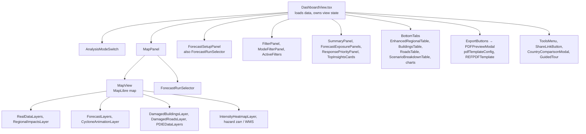

# Frontend guide

## Routes (`src/app`)

| Route | File | What |
|---|---|---|
| `/` | `page.tsx` | country chooser (redirects to the tenant country when `TENANT_COUNTRY` is set) |
| `/[country]` | `[country]/page.tsx` | the dashboard (`DashboardView`); slugs come from `config/` |
| `/[country]/login` | `[country]/login/page.tsx` | password page for a protected country |
| `/methodology` | `methodology/page.tsx` | how the numbers are made |
| `/operator` | `operator/page.tsx` | operator console: pipelines, runs, submit a track (Django superuser) |

API routes are in `src/app/api/`: `partner-proxy/[...path]`, `events`, `cyclone`, `auth/*`, `operator/*`, `buildings`, `roads`, `exposure`, `regions`, `regional-summary[-by-sector]`, `stats`, `data/[filename]`, `config`, `health` and `metrics`.

## Component map

`DashboardView.tsx` (about 4,100 lines) is the orchestrator. It reads the URL, calls `loadAllRealData`, keeps the loaded `RealDataLoadResult`, and passes slices down. When you add a feature, put the logic in a `utils/` module with tests and keep the component thin. Most of the domain logic already lives in `utils/` (`forecastRuns`, `forecastExposure`, `lossTotals`, `responsePriority`, `districtImpactRows`, …).

Both advisory pickers, in the map panel and in the forecast setup panel, are bound to the same state, so they cannot disagree.

## Map

- **MapLibre GL 5** is the base map, with **deck.gl 9** for heavy overlays. Basemaps are in `utils/basemaps.ts`.
- **Layer z-order** is in one table, `LAYER_ORDER` in `utils/layerOrder.ts`. Add a new layer there, or it goes on top with a console warning.
- Hazard layers come either from THREDDS WMS through the proxy (`threddsLoader`, `wmsTileCache`) or straight from the zarr store (`hazardZarrMapLayer`).
- Wind-glow particles and big parsing jobs run in workers (`src/workers/`).
- Accessibility: `MapAccessibleFeatures` opens the map's districts as a list (with population, damage and buildings) for keyboard and screen-reader users.

## View state and links

Everything a user would want in a shared link goes in the URL (`utils/urlState.ts`, `MapURLState`): map centre and zoom, region, hazards, sectors, events, date range, layers, map style, basemap, hazard scenario (`hazardScenarioProduct/Slr/ReturnPeriod/Event`) and `viewMode`. Use `serializeMapState` and `deserializeMapState`. Do not keep a shareable choice only in component state.

## Styling

- Tailwind CSS v4 (`@tailwindcss/postcss`).
- Colour and style tokens: `utils/colorSystem.ts`, `utils/styleConstants.ts`, `src/theme/` (`colors.ts`, `cycloneScale.ts`), `utils/forecastColors.ts`.
- Responsive labels are often rendered twice, a long and a short span, one hidden by CSS. A text scraper reads both ("Forecast (REF)Forecast (REF)"); that is not a bug users see.

## Exports

`ExportButtons` opens `PDFPreviewModal`, which renders a template from `pdfTemplateConfig.ts` (REF: `REFPDFTemplate.tsx`) with jsPDF and html2canvas. Static assets are in `public/pdf-assets/`. CSV and GeoJSON downloads go through the same buttons.

## Rules that are easy to break

- **Base path.** Write `fetch(prependBasePath('/api/...'))`, never `fetch('/api/...')`. Production runs under `/partner2`, and a bare path goes to the domain root. The same applies to `window.location` redirects and static asset URLs.
- **Country identity.** Use `CountryCode` in code and slugs in URLs (`utils/countrySlug.ts`). Do not hard-code country lists: read them from `src/config/registry.ts`.
- **Do not bring back deleted components** from old docs (StatsGrid, GlassStatCard, MethodologyDrawer, …).
- **New data columns** are translated in one place (`utils/pdieOutputs.ts` style), not in each component.
