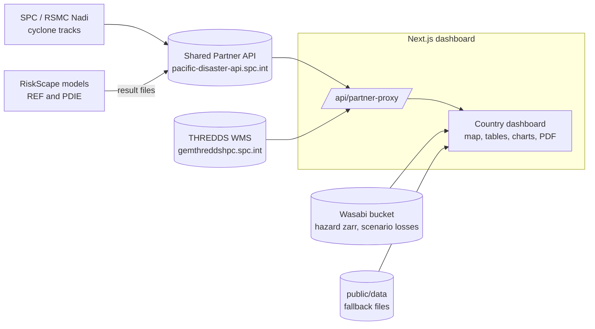

# Partner2 wiki

Partner2 (`climate-dashboard`) is the **Tropical Cyclone Rapid Impact Assessment Tool** for four Pacific countries: Vanuatu (`VU`), Samoa (`WS`), Tonga (`TO`) and the Cook Islands (`CK`). It shows, on one map, what a cyclone may expose (forecast), what it did damage (post-disaster), what could happen in future (planning scenarios) and what past storms did (history).

Live: <https://opmthredds.gem.spc.int/partner2> (one page per country, e.g. `/partner2/cook-islands`).

## Start here

| If you want to… | Read |
|---|---|
| Run the dashboard on your machine | [Getting started](Getting-Started.md) |
| Understand how the pieces fit | [Architecture](Architecture.md) |
| Learn the words (event, run, advisory, REF, PDIE, scenario) | [Domain model](Domain-Model.md) and [Glossary](Glossary.md) |
| Know where the data comes from and how it is loaded | [Data sources and loading](Data-Sources-and-Loading.md) |
| Read or add a model output file | [Model outputs (REF and PDIE)](Model-Outputs.md) |
| Change a screen or a map layer | [Frontend guide](Frontend-Guide.md) |
| Add a country, set an env var | [Configuration](Configuration.md) |
| Protect a country with a password, lock a deployment | [Auth and tenancy](Auth-and-Tenancy.md) |
| Work on the Django API in `middleware/` | [Backend (middleware)](Backend-Middleware.md) |
| Run or import a cyclone model | [Model runs and runners](Model-Runs-and-Runners.md) |
| Ship a new build | [Deployment](Deployment.md) |
| Run tests, pass the hooks | [Testing and quality](Testing-and-Quality.md) |
| Fix something that is broken | [Troubleshooting](Troubleshooting.md) |

## The system in one picture

## Facts that save time

- **The live dashboard reads only the shared API at `pacific-disaster-api.spc.int`**, which Anuj runs. The Django project in `middleware/` is our own copy of that API. Its deployment on opmthredds has a separate database and is **not** where the live dashboard gets its data. See [Data sources](Data-Sources-and-Loading.md#the-two-partner-apis).
- The server cannot run `next build` (not enough memory). Builds are made on a PC and shipped as an image. See [Deployment](Deployment.md).
- Dev runs on port **3002**, production on **3112** under the base path **`/partner2`**. Build every URL with `prependBasePath`.
- What is deployed now, what is in progress and what is waiting on others: [`WORKING.md`](../../WORKING.md). Read it before you start.

## Other documents in the repo

These pages summarise and link to the detailed documents. They do not replace them:

- [`AGENTS.md`](../../AGENTS.md): the condensed guide for coding agents and contributors.
- [`config/README.md`](../../config/README.md): the country, event and layer configuration contract.
- [`docs/SHARED_API.md`](../SHARED_API.md): the shared API's shape, quirks and open requests.
- [`docs/HAZARD_CATALOG_ZARR.md`](../HAZARD_CATALOG_ZARR.md): flood-depth zarr store and scenario losses on Wasabi.
- [`docs/EVENT_ARCHITECTURE.md`](../EVENT_ARCHITECTURE.md): why an event aggregates many regional impacts.
- [`middleware/runners/README.md`](../../middleware/runners/README.md) and [`STAGING.md`](../../middleware/runners/STAGING.md): model runners and their rollout.
- [`DEPLOYMENT.md`](../../DEPLOYMENT.md), [`SECURITY.md`](../../SECURITY.md), [`SECRETS_MANAGEMENT.md`](../../SECRETS_MANAGEMENT.md), [`MONITORING.md`](../../MONITORING.md), [`DISASTER_RECOVERY.md`](../../DISASTER_RECOVERY.md).

The ~80 `*_CRITIQUE.md` / `*_SUMMARY.md` notes at the repo root are history, not the current design. When they disagree with the code, the code wins.

## Using these pages as a GitHub wiki

The files are plain Markdown with relative links, so they read correctly on GitHub in `docs/wiki/`. To publish them as the repo's GitHub wiki, copy them into the `Partner2.wiki` repository: `Home.md` becomes the front page and `_Sidebar.md` the sidebar. The wiki then needs the `.md` suffix removed from links, e.g. `sed -i 's/\.md)/)/g' *.md`, applied only to links between wiki pages.
