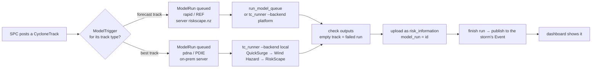

# Model runs and runners

The full reference is [`middleware/runners/README.md`](../../middleware/runners/README.md); the rollout order is in [`STAGING.md`](../../middleware/runners/STAGING.md). This page is the map.

## From a track to the dashboard



- **The queue is the database.** A run is claimed with a lease (`model/queueing.py`: `claim_next_run`, `finish_run`, `publish_run_to_event`). A run whose worker goes quiet for 2 hours (`MODEL_RUN_LEASE_SECONDS`) is requeued, up to 3 attempts (`MODEL_RUN_MAX_ATTEMPTS`). A queued forecast run is skipped when a newer advisory for the same storm arrives first.
- **Run exactly one worker per queue** (`server_name`).
- **Runners only call out over HTTPS**, so an on-prem server needs no inbound access.
- **One Event per storm and country.** Each advisory is a `ModelRun` in the event's `forecast_runs`. A best-track (PDIE) result replaces forecast results on the event, never the other way round.

## What the runner checks and fixes

| Problem | Handling |
|---|---|
| SPC track times like `2026-10-17 12:00:00` are dropped by RiskScape, which then "succeeds" with empty results | `cyclone_track/<id>/model_input/` serves ISO-UTC times; models use `{model_track_url}` |
| A model that could not read the track | **failed run**, not "no exposure" (empty-run check) |
| A track filed under the wrong country (SPC filed TC Wati under Fiji) | country chosen from `total-exposed-by-country.csv`: the most people exposed |
| Output file names | `DATASET_TYPE_BY_FILENAME` in `tc_runner.py` sets `dataset_type`. `SKIPPED_OUTPUTS` drops `event-loss-features-map.gpkg` (78 MB) |

## Setting up pipelines

```bash
python manage.py setup_tc_pipelines            # --create-track-types on an empty database
python manage.py run_model_queue --server-name riskscape.nz      # the worker (docker compose: runner)
python manage.py check_runner_health [--email]                   # for cron or a monitor
```

- **rapid**: official forecast tracks → `Rapid-Exposure-Forecast-GeoJSON` in `niwa/partner/rsmc-tcwc` on the RiskScape platform. It needs `RISKSCAPE_TOKEN` and `PARTNER_API_URL`, the public address the model fetches the track from.
- **pdna**: post-event best tracks → QuickSurge → Wind Hazard → RiskScape `Cyclone-PDIE` on `lotgemdev01`.
- Models, model chains (`next_model`), triggers and track types are all editable in the Django admin. Tracks added in the admin do **not** queue runs: use the "Queue model runs for selected tracks" action. Retry with "Requeue selected runs".

## Getting a finished run in by hand

| You have | Use |
|---|---|
| A RiskScape share link (`/shared/results/<token>`) | `manage.py ingest_riskscape_run <link> --country CK` |
| Output folders downloaded by `REF.sh` | `runners/push_outputs.sh` (zips each folder → `POST model_run/import/`) |
| A run number and a RiskScape key | `runners/fetch_run.py <run> <folder>`, then `manage.py import_ref_run <folder> --country CK --title ...` |

`push_outputs.sh`:

```bash
./push_outputs.sh --dry-run           # what would be sent
./push_outputs.sh                     # every run folder in outputs/, oldest first
./push_outputs.sh outputs/2026101906_Wati_20261019T060000Z
./push_outputs.sh --replace           # reload a run the server already has
```

The script needs `PARTNER_API_TOKEN`, a Partner API key and *not* the RiskScape key, in `.env` or the environment. It finds the SPC track by the cyclone name in the folder name, or by `TRACK_ID` in `<folder>/run.env`. It never sends the token to the track server.

> **Watch the target.** `push_outputs.sh` defaults to `PARTNER_API_URL=https://opmthredds.gem.spc.int/partner_api/v1`, which is **our middleware**, not the shared API the dashboard reads. The shared API also has no `model_run/import/` endpoint (404). A run pushed with the default reaches our database, not users. Loading data into the shared API is agreed with Anuj.

## Rules

- **Empty model outputs are a failed run, not zero exposure.**
- **Don't change the RiskScape model.** Adapt inputs and outputs around it.
- A run's name and time come from the advisory (`YYYYMMDDHH`, UTC). A wrong name or time puts the advisory in the wrong place in the picker; see [Domain model](Domain-Model.md#advisories-and-the-newest-rule).
